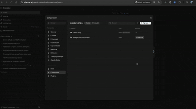

# MCP Shop Demo

Small product/user CRUD (FastAPI + PostgreSQL) exposed as a REST API and as an
MCP server (Streamable HTTP), so Claude can query stock, search products, manage
a cart, check out and read a best-seller KPI.



> **Two versions of this demo**
> - `main` (tag `v1-shared-token`): one shared bearer token, simple setup.
> - `feature/per-user-auth` (this branch): one token per user, so the cart and
>   order history belong to whoever is authenticated.

## Stack
Python 3.12 · FastAPI · SQLAlchemy 2 · PostgreSQL · MCP Python SDK (`mcp<2`) · ngrok / Railway

## Structure
```
app/
  config.py      env vars (dotenv), normalizes the DATABASE_URL driver
  database.py    engine and session
  models.py      users (with token_hash), products, cart_items, orders, order_items
  schemas.py     Pydantic models
  crud.py        business logic (cart, checkout, KPI, CSV import, token helpers)
  main.py        REST API + MCP mounted at /mcp
  mcp_server.py  MCP tools
  auth.py        per-user token middleware for /mcp
tests/           pytest (cart, checkout, KPI, tokens)
docs/            demo GIF
seed.py          sample data (8 products, 2 users)
issue_token.py   issues or rotates a user's token
```

## Setup
```bash
python -m venv env && source env/bin/activate
pip install -r requirements.txt
createdb mcp_demo
cp .env.example .env        # fill DATABASE_URL
python seed.py
python issue_token.py 1     # prints a token for user 1 (shown once)
python issue_token.py 2
uvicorn app.main:app --reload --port 8000
```

Only the SHA-256 hash of each token is stored. Re-running `issue_token.py`
rotates the token and invalidates the previous one.

## MCP tools
Public catalog: `get_total_stock`, `list_products`, `search_products`,
`get_product`, `create_product`, `update_product`, `import_products_from_csv`,
`get_top_product`.

Per authenticated user (no `user_id` argument): `whoami`, `view_cart`,
`add_to_cart`, `remove_from_cart`, `checkout`, `list_orders`.

Stock is only reduced when `checkout` completes.

## Connect to Claude
1. Expose the server: `ngrok http 8000` (local) or use your Railway URL (see below)
2. Settings → Connectors → Add custom connector, authentication "No sign-in"
3. URL: `https://<host>/mcp?token=<USER_TOKEN>`
   (or the header `authorization: Bearer <USER_TOKEN>` if available)
4. Add a second connector with another user's token to see isolated carts.

Example prompts: "Who am I?", "What is the total stock?", "Add 2 keyboards to
my cart and check out", "What is the best-selling product?"

## Deploy on Railway
1. Create a project from this GitHub repo and set the production branch to
   `feature/per-user-auth`.
2. Add a PostgreSQL service and, in the app service variables, set
   `DATABASE_URL=${{<postgres-service>.DATABASE_URL}}` (the app rewrites the
   driver prefix to `postgresql+psycopg2://`).
3. Custom start command:
   `uvicorn app.main:app --host 0.0.0.0 --port $PORT`
4. Seed the data and issue tokens from the service console:
   ```bash
   source /app/.venv/bin/activate
   python seed.py
   python issue_token.py 1
   python issue_token.py 2
   ```
5. Generate a public domain and use `https://<app>.up.railway.app/mcp?token=<USER_TOKEN>`
   as the connector URL.

## REST API
Interactive docs at `http://localhost:8000/docs`. Catalog and stock endpoints
live under `/products`, `/stock` and `/kpi`. The cart and orders of the
authenticated user are under `/me`, `/me/cart`, `/me/checkout` and `/me/orders`,
all with `Authorization: Bearer <USER_TOKEN>`.

## Tests
```bash
createdb mcp_demo_test
pip install -r requirements-dev.txt
pytest -q
```